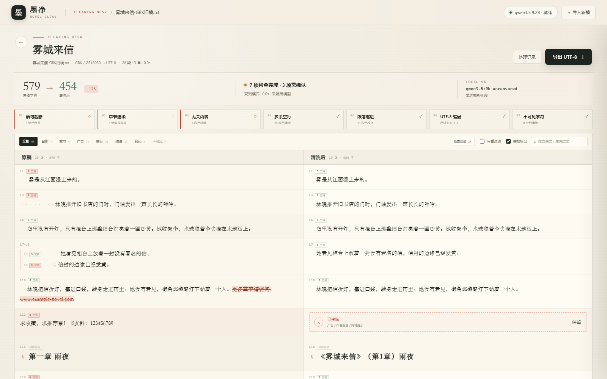

# 墨净 · 小说数据清洗台

[](https://github.com/chongrui20130326-web/novel-clean/actions/workflows/tests.yml)
[](https://github.com/chongrui20130326-web/novel-clean/releases)
[](LICENSE)

一个**本地优先**的小说清洗工具：规则负责可机械验证的部分，本地模型路由只复核语义疑点，最后用左右对比的 HMI 把「改了什么、为什么改」摊开。

> 下载：[最新 Release](https://github.com/chongrui20130326-web/novel-clean/releases) · 问题：[Issues](https://github.com/chongrui20130326-web/novel-clean/issues) · 开发集成：[docs/INTEGRATION.md](docs/INTEGRATION.md)



---

## 1. 它能做什么

导入 `.txt` / `.md` 小说，完成七项检查并生成 UTF-8 清洗稿：

| # | 检查 | 执行方式 | 结果 |
|---|---|---|---|
| 01 | **语句被异常截断** | 行尾/引号/虚词/句式规则初筛 → 模型判断是否同一句 → 软件逐字拼接并校验 | 合并被回车拆开的句子，可逐条撤销 |
| 02 | **章节名连续与格式** | 解析章/节/回/括号数字编号，检查缺章、重号、倒序；统一标题格式 | 标题统一为「《书名》（第N章）原标题」；报告断点，**不编造缺失章节** |
| 03 | **小说不相关信息** | 网址、联系方式、广告词、纯符号规则 → 模型判断整段是否删除 | 广告/作者留言/网站导航整段移除；正文夹带的网址只删网址 |
| 04 | **多余空行** | 段间空行、章节前空行、首尾空行 | 段间清零；章节前最多留 1 行 |
| 05 | **每段 5 个空格** | 统计段首半角空格，标题要求顶格 | 全部正文统一为 5 个 ASCII 空格 |
| 06 | **UTF-8 编码** | BOM / UTF-8 / UTF-16 / UTF-32 / GB18030 / Big5 检测 | 输出 UTF-8，无 BOM |
| 07 | **不可见字符** | ZWSP、BOM、NBSP、软连字符、双向控制符、变体选择符、控制字符 | 扫描、定位、清除；可逐条查看 |

> “5 个空格”指 5 个半角空格 `U+0020`，不是 2 个全角空格。章节标题不缩进。

### 书名与章节标题

导入文件、本地路径或粘贴文本时，会先弹出书名：

- 输入书名 → 作为文档标题和导出文件名
- 留空 / 跳过 / 关闭弹窗 → 使用文件名（去掉扩展名）

章节标题统一规则：

```text
第一章 雨夜        →  《雾城来信》（第1章）雨夜
第001章：旧信      →  《雾城来信》（第1章）旧信
第一章，           →  《雾城来信》（第1章）
(12)               →  《雾城来信》（第12章）
（14）             →  《雾城来信》（第14章）
(12) 标题          →  《雾城来信》（第12章）标题
二十二章           →  《雾城来信》（第22章）
二十三章 标题      →  《雾城来信》（第23章）标题
第2章              →  《雾城来信》（第2章）
序章               →  《雾城来信》序章
```

- 书名 + 全角括号内的阿拉伯数字章节号 + 原标题
- 序号统一为阿拉伯数字 + `章`；原稿的 `节` / `回` 也归一为 `章`
- 单独一行的 `(12)` / `（14）` 也识别为章节号
- 省略「第」的 `二十二章` / `12章` 也识别
- 行尾带 `，` / `。` / `：` 等标点也能识别，标点会被去掉
- `【书名】 (11)` 这种发帖元信息不会被当成章节；紧跟其后的 `第十一章，` 才是章节
- 每个章节标题独占一行
- 书名回退时使用文件名（去掉扩展名）

### 对比界面


- 左：原稿；右：清洗后，双栏占满宽度
- **默认一次加载全文**，没有分页，也没有“加载更多”
- 检查记录在右上角「检查记录」抽屉里，不再常驻挤压正文
- 行内标签默认收起，只保留行号、缩进和文字差异
- 删除线：被移除的广告/网址/不可见字符
- `⟨ZW⟩`：零宽字符；`⟨␠⟩`：异常空格/制表符
- 两行原稿被合并时，右侧只留合并后的结果
- “已移除”卡片可以点“保留”撤销删除
- 打开检查记录后，每条修复可以单独应用/取消；统计和导出同步更新

侧栏宽度 ≥ 640px 时保持左右双栏，只有真正窄于 640px 才上下叠。

---

## 2. 快速开始

```bash
git clone https://github.com/chongrui20130326-web/novel-clean.git
cd novel-clean
npm start
```

打开：

```text
http://127.0.0.1:4180/
```

侧栏 / iframe：

```text
http://127.0.0.1:4180/?embed=1
```

可选参数：

- `?demo=1`：自动载入 GBK 示例稿
- `?demo=utf8`：自动载入 UTF-8 BOM 示例稿
- `?ai=0`：只跑规则模式
- `?embed=1`：启用侧栏响应式布局
- `?job=<jobId>`：从 `.data/jobs` 恢复已完成任务，服务重启后不用重新导入

依赖：

- Node.js **>= 22**（原生 `fetch`、`WebSocket`、`node:assert`）
- 本地模型路由：默认按本机 `J:\本地模型服务器`，地址 `http://127.0.0.1:8090/v1`；其他路径可用 `MODEL_ROUTER_ROOT` 覆盖
- 路由后面接 Ollama 或 Strata；路由不可用时自动退回规则模式

### 本地模型路由

模型调用统一走本机 OpenAI 兼容路由，不再直连 Ollama：

```text
http://127.0.0.1:8090/v1
```

启动路由：

```powershell
cd 'J:\本地模型服务器'
.\start.ps1
```

可用模型：

```text
qwen3.5:0.8b
qwen3.5:2b
qwen3.5:4b
qwen3.5:9b-uncensored   默认
strata-q2
strata-q3
strata-q4
```

- 切换模型：点右上角模型胶囊 `9B · 就绪 ▾`，每次打开都会重新读取 `/v1/models`；弹窗里也有「刷新」
- 模型下拉框会从 `/v1/models` 动态读取
- `qwen3.5:*` 走 Ollama；`strata-q*` 由路由按需启动
- 请求统一带 `reasoning_effort: "none"`，避免思考 token 挤占 JSON 输出
- 清洗进度显示最近一批模型的 `token/s`；Strata 用后端 `predicted_per_second`，Ollama 用完成 token / 耗时估算（会包含加载时间）
- JSON 结构优先用 `response_format`；后端不支持时自动降级
- 首次加载 Strata 可能较慢，超时设为 15 分钟
- `service/watchdog.ps1` 也会检查 `8090`，路由没启动时自动拉起

可覆盖环境变量：

```text
MODEL_GATEWAY_BASE=http://127.0.0.1:8090
MODEL_GATEWAY_MODEL=qwen3.5:9b-uncensored
MODEL_GATEWAY_API_KEY=local
```

### 服务自动恢复

服务不依赖当前终端：登录 Windows 后自动启动看门狗，看门狗每 4 秒检查 `4180`，发现服务不在就重新拉起 `server.mjs`；同时检查 `8090`，模型路由没启动时自动运行 `J:\本地模型服务器\start.ps1`。

```text
service/
├── watchdog.ps1          端口守护 + 自动重启
├── watchdog.vbs          隐藏窗口启动
└── install-autostart.ps1 创建登录启动快捷方式
```

安装/修复：

```powershell
powershell.exe -NoProfile -ExecutionPolicy Bypass -File service\install-autostart.ps1
```

启动项：

```text
%APPDATA%\Microsoft\Windows\Start Menu\Programs\Startup\NovelClean.lnk
```

日志：

```text
service/watchdog.log
```

正常使用时只需要：

1. 打开墨净页面
2. 选择文件 → 开始清洗

不需要手动启动 `node server.mjs`。服务被结束后通常会在 10 秒内自动恢复。

### 导入失败排查

侧栏 webview 偶尔会出现“文件选择器选完但 `File.size = 0`”或拿不到文件内容的情况。导入卡会显示具体原因，并提供两条兜底：

1. **本地路径导入**：展开「文件选择器没反应，或选完提示 0 字节？」→ 填绝对路径，例如 `C:\Users\you\Documents\小说.txt`。
2. **粘贴文本**：点「粘贴文本」，把正文贴进来。

常见原因：文件超过 32 MB、空文件、云盘占位符尚未下载、文件类型未被选择器接受。

### 导出工程

侧栏 webview 不允许 `Content-Disposition` 下载。点「导出工程」会打开保存框：

- **保存目录**：可以填任意本机目录，例如 `D:\小说\导出`；留空使用 `Downloads`
- 目录不存在会自动创建
- 在所选目录下生成 `<书名>-工程/`

```text
<书名>-工程/
├── source.txt          原稿源文件
├── target.utf8.txt     当前清洗结果，UTF-8 无 BOM
├── project.json        工程索引
├── report.json         清洗报告
├── state.json          内部快照（逐条开关、二次渲染）
└── README.md           人读说明
```

工程可以重新加载：

```text
墨净 → 打开已有工程 → 填写/选择 <书名>-工程 目录
```

加载后会恢复：

- 源文件与书名
- 当前目标文本
- 七项检查与章节状态
- 全量 issue 与逐条开关（`disabled`）
- 内部 snapshot，可继续逐条取舍、重渲染、再次导出

报告包含：

- `schema` / `generatedAt` / 应用版本
- 源文件、编码、换行符、字数、源文件 SHA-256
- 七项检查结果
- 章节统计、连续性、格式统一数量、缺口
- 全量 issue：id、类型、行号、blockIds、before/after、是否应用
- 用户逐条关闭的 issue id（`disabled`）
- 正文路径、字节数、正文 SHA-256
- AI 调用、模型名、耗时

界面导出成功后会显示工程目录、目标文件、报告、索引说明四条完整路径。

> 工程导出依赖导入时保留的源文件。升级前已经生成的旧任务没有源文件快照，请重新导入原文件一次；新任务会自动保留。

---

## 3. API

| 方法 | 路径 | 说明 |
|---|---|---|
| `GET` | `/api/health` | 本地模型路由 / 模型状态 |
| `GET` | `/api/sample?format=utf8\|gbk` | 下载示例稿 |
| `POST` | `/api/analyze` | 原始字节、JSON `{text}` 或 `?path=` 本地路径 |
| `GET` | `/api/jobs/:id` | 任务状态与统计 |
| `GET` | `/api/jobs/:id/blocks?filter=&offset=&limit=` | 对比块；`limit=all` 返回全量 |
| `GET` | `/api/jobs/:id/issues?type=&info=` | 检查记录 |
| `POST` | `/api/jobs/:id/render` | `{disabled:[...]}`，重新渲染 |
| `GET` | `/api/jobs/:id/export` | 下载 UTF-8 文本 |
| `GET` | `/api/jobs/:id/report` | 下载 `.report.json` |
| `POST` | `/api/jobs/:id/save?dir=` | 保存正文 + 报告到指定目录 |
| `POST` | `/api/jobs/:id/project?dir=` | 导出完整工程目录 |
| `POST` | `/api/projects/open?path=` | 重新加载工程，返回新 jobId |

分析请求参数：

```text
name=文件名
bookName=书名
ai=1|0
model=模型名
path=本地绝对路径（可选）
```

`path` 由本机服务直接读取，绕过浏览器文件选择器；服务只监听 `127.0.0.1`。

---

## 4. 设计

### 规则 + 模型的分工

```text
原始字节
  │  编码检测 / BOM / 换行归一
  ▼
不可见字符扫描
  │
  ▼
章节 / 段落 / 空行解析
  │
  ▼
规则初筛：截断、章节、广告、空行、缩进
  │
  ▼
模型只复核语义疑点（截断是否同句、段落是否广告）
  │
  ▼
结构动作由软件执行：合并、删除、缩进、章节标题、导出
```

**章节号由规则引擎识别，不交给模型。** 模型不擅长逐章编号推理；`(12)`、`（14）` 这类格式由确定性正则处理。

**模型不是执行者。** 模型返回 JSON 后做 schema 校验；合并要求模型输出与原行拼接完全一致，否则退回确定性拼接。删除要求有 URL、联系方式、广告词、纯符号等硬证据，短叙事默认保留。

**缺失章节只报告。** 软件不会替作者写“第 3 章”。

**模型掉线自动降级。** 任务仍然完成，HMI 标注“规则模式”。

**编号稳定。** 段落有稳定 `B0001` 编号，前端逐条开关只重跑 `renderDocument()`，不重新调用模型。

### 章节格式的边界

- `第一章，`、`第一章。`：行尾标点先剥掉再识别
- `(12)`、`（14）`：单独一行识别为章节号
- `(12) 标题`：括号章节号 + 原标题
- `【书名】 (11)`：不当作章节；后面的 `第十一章，` 才是章节
- `见第一章，他走了。`：正文引用，不当作章节标题
- 章节标题顶格；正文统一 5 个半角空格

### 段落与空行

- 段与段之间不保留空行
- 章节标题前最多 1 行空行
- 首尾空行清零
- 章节标题独占一行

### 广告与 URL

- 短广告段落整段删除
- 长正文里夹带的网址只删 URL 及其紧邻的“更多章节请访问”等广告前缀
- 删除必须带硬证据，避免误删正常叙事

---

## 5. 测试

```bash
npm test
npm run test:http
```

引擎回归覆盖：

- UTF-8 BOM / GBK / UTF-16 LE / CRLF
- 章节标题 `《书名》（第N章）原标题` 归一
- `第一章，`、`(12)`、`（14）` 等章节号
- 7 类不可见字符定位
- 规则 + 模型复核（mock）
- 合并撤销 / 恢复
- 幂等重跑
- 模型不可用时降级
- 本地路由模型列表 / OpenAI 兼容请求
- 导出 UTF-8 无 BOM

当前结果：

```text
14 tests passed.
```

HTTP 回归覆盖：

- 任务完成、统计
- 章节筛选
- 导出字节与 BOM
- 指定目录保存：正文 + report.json，7 项检查与全量 issue
- 工程导出与重新加载：source / target / project / report / state / README
- 逐条开关重渲染

---

## 6. 限制

- **不编造缺失章节。** 只报告断点。
- **章节重号不自动改。** 避免破坏目录引用。
- **默认一次加载全文。** 正文很长时首屏渲染会慢一些，换来完整对照。
- **32 MB 上限。** 超过请拆分。
- **5 空格是硬规则。** 如果目标平台要求 2 个全角空格，需改 `render.mjs` 的 `BODY_INDENT` 和 `detect.mjs` 的缩进检查。
- **模型输出有概率性。** 所有结构动作由软件执行并二次校验；模型只是建议者。
- **只监听本机。** 服务默认绑定 `127.0.0.1`，稿件不上传。

---

## 7. 目录

```text
novel-clean/
├── server.mjs                 HTTP / 队列 / 导出 / 本地路径导入
├── core/
│   ├── encoding.mjs           BOM / UTF-8 / UTF-16 / GB18030 / Big5
│   ├── invisible.mjs          不可见字符扫描与清除
│   ├── parse.mjs              章节 / 段落 / 空行；章节标题格式
│   ├── detect.mjs             截断、章节、广告、空行、缩进规则
│   ├── ai.mjs                 本地模型路由客户端、JSON Schema、安全校验
│   ├── report.mjs             可追溯报告（JSON）
│   ├── snapshot.mjs           snapshot 的 Map/Set JSON 序列化
│   ├── render.mjs             最终文本、对比块、5 空格缩进
│   └── pipeline.mjs           清洗流水线、逐条重渲染
├── ui/                        index.html / style.css / app.js
├── service/                    登录自启 + 看门狗
├── samples/                   UTF-8 BOM / GBK 示例
├── docs/INTEGRATION.md        二次开发与宿主集成说明
├── screenshots/               HMI 截图
├── tools/
│   ├── test.mjs               引擎回归（14 项）
│   └── test-http.mjs          HTTP / 导出 / 撤销回归
└── README.md
```

---

## 8. 侧栏

DSH 右侧栏打开：

```text
http://127.0.0.1:4180/?embed=1
```

桌面快捷键 `Ctrl + Alt + B` 切换右侧栏；在侧栏里 `Ctrl + T` 新开浏览器标签。

当前已加载的页面不会自动更新；重新导入后才会应用最新规则。

